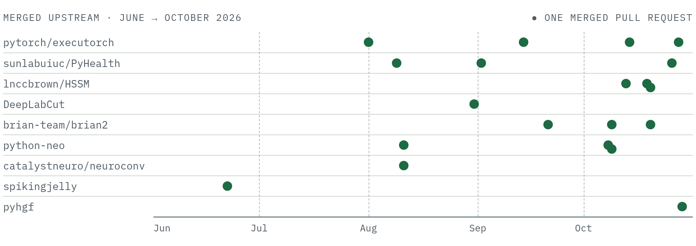
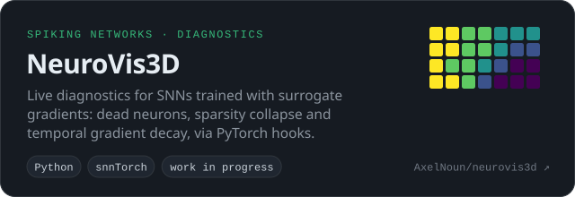
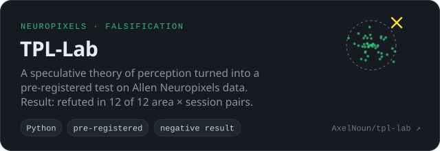
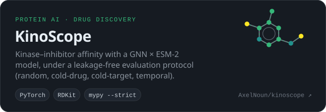
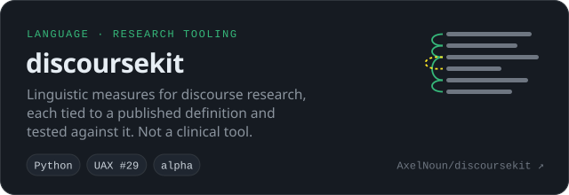

  
  
  
  
  

  
  
  
  

### I find the bugs that don't crash.

A parameter order that silently permutes a model's predictive draws. A CI step that stays green when its command fails. An error guard that can never fire. I work on **spiking neural networks, computational neuroscience and efficient inference**, and most of what I do comes down to one question: *is the number this tool gives me actually true?*

I'm self-taught: oncology, then bioinformatics, then AI for proteins, and now neuromorphic computing. With no lab behind me, I built my track record where anyone can check it: in other people's code, reviewed and merged by their maintainers.

Where my work sits: recording brains, chips that compute on events, and models that only activate what they need.

## Selected contributions

| Project | What I fixed or built |
|:--|:--|
| **PyTorch ExecuTorch**  Meta · on-device inference | [**#20685**](https://github.com/pytorch/executorch/pull/20685) · Runtime **Mixture-of-Experts expert-sort** for the MLX backend's decode path: two custom ops, a wire-compatible FlatBuffer field, C++ interpreter changes, and a stride bug traced down into MLX's `matmul.cpp`.  💬 *"Tested locally. Improves Qwen3.5 perf from 73 tok/sec to 80 tok/sec. Great job!"* — reviewer |
| **HSSM**  Brown University · cognitive modelling | [**#1371**](https://github.com/lnccbrown/HSSM/pull/1371) · The `racing_diffusion_3` parameter order didn't match the simulator's. Fits looked fine; **posterior-predictive draws were silently wrong**. Fix plus a test over 21 model/likelihood pairs.  💬 *"Looks good, and thanks for catching the issue."* — maintainer |
| **pyhgf**  computational psychiatry | [**#451**](https://github.com/ComputationalPsychiatry/pyhgf/pull/451) · Fixed the **batched weight gradient of binary layers** in `rshgf.DeepNetwork`, a bug that changed the results of releases 0.3.1 and 0.3.2. The maintainer kept the regression test: it fails on the old code and passes on the fix. |
| **Brian2**  spiking network simulator | [**#1861**](https://github.com/brian-team/brian2/pull/1861) · Removed a ~80 ms `gc.collect()` from every `Network.run()` when the warning it served is disabled, with a regression test.  💬 *"This makes perfect sense to me, and everything looks good."* — maintainer |
| **python-neo**  electrophysiology I/O | [**#1891**](https://github.com/NeuralEnsemble/python-neo/pull/1891) · Spike2 (CED) files stopped loading with sonpy ≥ 1.9.12, which ships three import layouts by version and platform. Restored reading and re-enabled the CED tests. Invited onto the project's authors list.  💬 *"Looks great. Thanks."* — maintainer |
| **DeepLabCut**  pose estimation | [**#3445**](https://github.com/DeepLabCut/DeepLabCut/pull/3445) · pandas 3 Copy-on-Write: made ten in-place mutations of read-only arrays safe across eight modules.  💬 *"great PR, thanks for your contribution!"* — maintainer |
| **PyHealth**  UIUC · clinical ML | [**#1179**](https://github.com/sunlabuiuc/PyHealth/pull/1179) · Support for the **MEDS** medical-event data standard: a typed Parquet scan path, a schema guard, tests, docs and a MIMIC-IV demo (+1.5k lines). |
| **SpikingJelly**  SNN framework | [**#692**](https://github.com/fangwei123456/spikingjelly/pull/692) · `LIAFNode` could not be initialised because of a dead assertion. Fixed, closing [#655](https://github.com/fangwei123456/spikingjelly/issues/655). |

#### Latest merges · live

<!-- live:start -->
- `2026-11-09` **[pytorch/executorch #24484](https://github.com/pytorch/executorch/pull/24484)**: \[XNNPACK\] Compose stacked activations in FuseActivationPass instead of overwriting
- `2026-11-09` **[brian-team/brian2 #1903](https://github.com/brian-team/brian2/pull/1903)**: Return copies, not views on C++ dynamic arrays, from x\[:\] and StateMonitor accessors (regression since 2.10)
- `2026-11-04` **[pytorch/executorch #24202](https://github.com/pytorch/executorch/pull/24202)**: Raise InternalError for non-CPU constant storage in the emitter
- `2026-11-04` **[fangwei123456/spikingjelly #808](https://github.com/fangwei123456/spikingjelly/pull/808)**: Fix empty intervals and boundary rounding in time-based frame splitting
- `2026-11-04` **[fangwei123456/spikingjelly #809](https://github.com/fangwei123456/spikingjelly/pull/809)**: Download the SSC archives in SpikingSpeechCommands

Refreshed daily by GitHub Actions · last run 2026-11-10
<!-- live:end -->

<!-- open:start -->
Open and under review: [brian2 #1891](https://github.com/brian-team/brian2/pull/1891) (Cython Binomial sampler wrong for p > 0.5 and non-terminating on underflow), [HSSM #1414](https://github.com/lnccbrown/HSSM/pull/1414) (approved), [huggingface/course #1328](https://github.com/huggingface/course/pull/1328), [PyHealth #1202](https://github.com/sunlabuiuc/PyHealth/pull/1202) (knowledge-graph embeddings on the 2.0 pipeline, negatives drawn from training triples only), [PyHealth #1207](https://github.com/sunlabuiuc/PyHealth/pull/1207) (deterministic, collision-free task cache keys), [python-neo #1913](https://github.com/NeuralEnsemble/python-neo/pull/1913).
<!-- open:end -->

### Where my code is merged

| Project | Field | Merged (live) |
|:--|:--|:--:|
| [PyTorch ExecuTorch](https://github.com/pytorch/executorch/pulls?q=is%3Apr+author%3AAxelNoun+is%3Amerged) | on-device inference runtime (Meta) |  |
| [pyhgf](https://github.com/ComputationalPsychiatry/pyhgf/pulls?q=is%3Apr+author%3AAxelNoun+is%3Amerged) | hierarchical Gaussian filters, computational psychiatry |  |
| [Brian2](https://github.com/brian-team/brian2/pulls?q=is%3Apr+author%3AAxelNoun+is%3Amerged) | spiking neural network simulator |  |
| [HSSM](https://github.com/lnccbrown/HSSM/pulls?q=is%3Apr+author%3AAxelNoun+is%3Amerged) | hierarchical sequential sampling models (Brown) |  |
| [python-neo](https://github.com/NeuralEnsemble/python-neo/pulls?q=is%3Apr+author%3AAxelNoun+is%3Amerged) | electrophysiology file I/O |  |
| [PyHealth](https://github.com/sunlabuiuc/PyHealth/pulls?q=is%3Apr+author%3AAxelNoun+is%3Amerged) | clinical machine learning (UIUC) |  |
| [SpikingJelly](https://github.com/fangwei123456/spikingjelly/pulls?q=is%3Apr+author%3AAxelNoun+is%3Amerged) | spiking neural network framework |  |
| [NeuroConv](https://github.com/catalystneuro/neuroconv/pulls?q=is%3Apr+author%3AAxelNoun+is%3Amerged) | neurophysiology data to NWB |  |
| [DeepLabCut](https://github.com/DeepLabCut/DeepLabCut/pulls?q=is%3Apr+author%3AAxelNoun+is%3Amerged) | markerless pose estimation |  |

<b>All merged pull requests, one line each</b>

 

<!-- merged:start -->
<picture>
  <source media="(prefers-color-scheme: dark)" srcset="assets/merged-dark.png">
  
</picture>

| Project | What I fixed or built | Maintainer's words |
|---|---|---|
| [pytorch/executorch #20685](https://github.com/pytorch/executorch/pull/20685) | Runtime MoE expert-sort for the MLX backend: two custom ops, a wire-compatible FlatBuffer field, C++ interpreter changes, a serialization fix, and a stride bug traced into Apple's MLX `matmul.cpp` | "Tested locally. Improves Qwen3.5 perf from 73 tok/sec to 80 tok/sec. Great job!" |
| [pytorch/executorch #22372](https://github.com/pytorch/executorch/pull/22372) | Vulkan quantizer lifted integer scalars as float32 and broke integer indexing; fix + test + Buck target | merged, no changes requested |
| [pytorch/executorch #22373](https://github.com/pytorch/executorch/pull/22373) | Four error guards that could never fire (unraised exceptions, always-true `assert`) made to actually raise; tests | merged |
| [pytorch/executorch #23798](https://github.com/pytorch/executorch/pull/23798) | [muse-glimmer] Fix bf16 positional embedding interpolation on CPU | merged |
| [sunlabuiuc/PyHealth #1179](https://github.com/sunlabuiuc/PyHealth/pull/1179) | MEDS (Medical Event Data Standard) dataset support: typed Parquet scan path, schema guard, tests, docs, MIMIC-IV demo (+1,526 lines) | "lgtm" |
| [sunlabuiuc/PyHealth #1203](https://github.com/sunlabuiuc/PyHealth/pull/1203) | External review of an OMOP drug-recommendation task: found a self-leakage bug and a fixture that could not detect the regression it targeted; two hardening commits integrated | author merged my commits |
| [sunlabuiuc/PyHealth #1187](https://github.com/sunlabuiuc/PyHealth/pull/1187) | Add PTB-XL dataset support (ECG) | merged |
| [lnccbrown/HSSM #1371](https://github.com/lnccbrown/HSSM/pull/1371) | Parameter order permuted between HSSM and ssm-simulators: fits were fine, predictive draws silently wrong; fix + test over 21 model/likelihood pairs | "Looks good, and thanks for catching the issue." |
| [lnccbrown/HSSM #1411](https://github.com/lnccbrown/HSSM/pull/1411) | The balanced-panel error message suggested `sort_values('participant_id')`, an unstable sort that scrambles each participant's trial order (which the RL likelihood reads) and still passes validation; stable sort suggested, docstrings, tests | "…this is a real bug and a clean fix." |
| [lnccbrown/HSSM #1415](https://github.com/lnccbrown/HSSM/pull/1415) | Follow-up to #1411 from the maintainer's review: the test of the balanced-panel check sorted with the default (unstable) sort that #1410 warns against; it now uses `kind="stable"` | "lgtm! thanks @AxelNoun" |
| [DeepLabCut #3445](https://github.com/DeepLabCut/DeepLabCut/pull/3445) | pandas 3 Copy-on-Write: ten in-place mutations on read-only arrays made safe across eight modules | "definitely correct and very helpful!" |
| [brian-team/brian2 #1861](https://github.com/brian-team/brian2/pull/1861) | ~80 ms `gc.collect()` per `Network.run()` skipped when the warning it served is disabled; regression test | "This makes perfect sense to me, and everything looks good." |
| [brian-team/brian2 #1885](https://github.com/brian-team/brian2/pull/1885) | Developer guidelines refresh (scope I proposed in #1827/#1829) | "Thanks, LGTM!" |
| [brian-team/brian2 #1896](https://github.com/brian-team/brian2/pull/1896) | Dangling pointer diagnosed in #1893: the random state now stores the Cython random-number buffers by value instead of the address of a buffer freed on refill, so `restore()` no longer reads freed memory; older stored states handled with a warning; test | "Thanks, LGTM!" |
| [NeuralEnsemble/python-neo #1891](https://github.com/NeuralEnsemble/python-neo/pull/1891) | `CedRawIO` broken by sonpy ≥ 1.9.12 (three import layouts by version and platform); CED tests re-enabled; test extra fixed | "Looks great. Thanks." — added to the neo 0.14.6 author list |
| [NeuralEnsemble/python-neo #1912](https://github.com/NeuralEnsemble/python-neo/pull/1912) | CI step stayed green when `git ls-remote` failed (exit status of `echo`); `pipefail`, emptiness check, error annotation; backed by log counts | approved by two maintainers |
| [NeuralEnsemble/python-neo #1911](https://github.com/NeuralEnsemble/python-neo/pull/1911) | Python 3.9 dropped from a matrix that had failed weekly since February | approved |
| [catalystneuro/neuroconv #1855](https://github.com/catalystneuro/neuroconv/pull/1855) | `spike2` extra had a PEP 508 marker that could never be satisfied; platform-aware test | "This is ready to go" |
| [fangwei123456/spikingjelly #692](https://github.com/fangwei123456/spikingjelly/pull/692) | Dead assertion on an attribute never defined in the repository's history | merged |
| [ComputationalPsychiatry/pyhgf #448](https://github.com/ComputationalPsychiatry/pyhgf/pull/448) | Use all volatility and value children in the unbounded volatility update | merged |
<!-- merged:end -->

### Diagnoses maintainers agreed with

- [pytorch/pytorch #200949](https://github.com/pytorch/pytorch/issues/200949) — `grid_sample` on CPU returns wrong values for fp16/bf16 when a gather offset exceeds 32,767 (int16 offset overflow in the vectorized kernel). Labelled "module: correctness (silent)".
- [brian2 #1893](https://github.com/brian-team/brian2/issues/1893) — `restore(restore_random_state=True)` uses a dangling pointer after a RNG buffer refill (Cython target). Maintainer: "I agree with the analysis and the proposed solution." Fixed in [#1896](https://github.com/brian-team/brian2/pull/1896), merged.
- [ml-explore/mlx-lm #1700](https://github.com/ml-explore/mlx-lm/issues/1700) — fused Metal KL/JS kernels reused one threadgroup buffer for max and sum exchanges without a barrier; my fix ([#1719](https://github.com/ml-explore/mlx-lm/pull/1719)) was reproduced independently on an M5 Max (26/50 → 0/50 mismatches). Closed by the maintainers for review capacity, not on technical grounds.
- [PCNtoolkit #600](https://github.com/predictive-clinical-neuroscience/PCNtoolkit/issues/600) — MLL/MSLL used the posterior mean of log p instead of log p(y | D, x) (Jensen bias). Collaborator: "To me it makes sense… I would change it."

## Built in the open

My own repositories say what has been validated and what hasn't. A clean negative result counts as a result.

&nbsp;

&nbsp;

<!-- projects:start -->
- [discoursekit](https://github.com/AxelNoun/discoursekit) — linguistic measures for discourse research; UAX #29 tokenizer that passes the official conformance test, MATTR, embedding-based coherence, permutation-test segmentation. 344 tests, `ruff` and `mypy` clean, doctests run as tests.
- [kinoscope](https://github.com/AxelNoun/kinoscope) — kinase–inhibitor affinity prediction under a leakage-free, four-regime evaluation protocol (random, cold-drug, cold-target, temporal) with an automated leakage audit in CI and Hypothesis property tests. No model trained yet; the README says so.
- [tpl-lab](https://github.com/AxelNoun/tpl-lab) — a pre-registered falsification test of a geometric conjecture on Allen Neuropixels recordings; decision rule frozen before the data; 12/12 refuted. Latest release: [v0.1.0](https://github.com/AxelNoun/tpl-lab/releases/tag/v0.1.0).
- [neurovis3d](https://github.com/AxelNoun/neurovis3d) — diagnostics for spiking neural networks (snnTorch): dead-neuron ratio, sparsity, temporal gradient signature. Work in progress; indicators not yet validated against analytical ground truth.
<!-- projects:end -->

## Activity · live

## Toolbox

  
  
  
  
  
  
  
  
  
  
  
  
  
  

| | |
|:--|:--|
| **Spiking & neuroscience** | snnTorch · SpikingJelly · Brian2 · Neo · NeuroConv / NWB · Allen Neuropixels · HSSM · pyhgf |
| **Inference & systems** | PyTorch · ExecuTorch (XNNPACK, Vulkan, MLX backends) · MLX · dynamic shapes · quantisation paths |
| **Health & bio data** | PyHealth · MEDS · PTB-XL · MIMIC-IV · RDKit · ESM-2 · PyTorch Geometric |
| **Engineering practice** | pytest & Hypothesis · mypy `--strict` · ruff · CI · packaging · pre-registration |

## What I'm looking for

**Full-time roles** in neuromorphic and event-driven computing, neurotech and BCI, computational-neuroscience tooling, or ML inference. I'm also open to **contracts**: bugs that falsify results, scientific-stack migrations (pandas 3, NumPy 2, Python 3.14, Cython), correctness and evaluation reviews of ML and scientific code.

Based in France (CET). French native, English for written work. Long term, I want to bring computational models closer to clinical medicine.

The fastest way to reach me is [email](mailto:axel.cffrd.dnty@icloud.com). I'm glad to start with a written exchange or a short trial task on your codebase.

